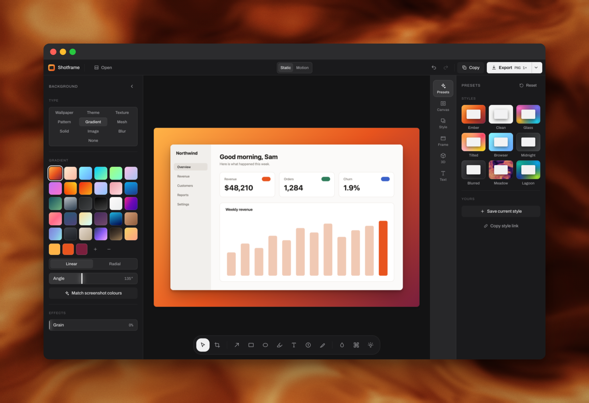
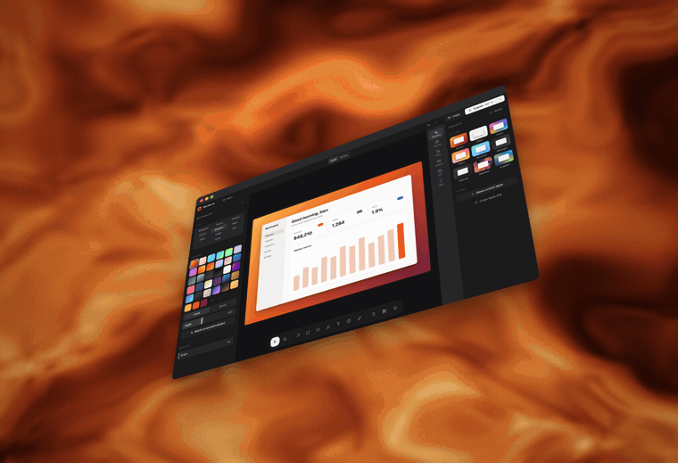

# Shotframe

Make screenshots look good. Paste one in, style it, export it as an image or an animated MP4. Everything runs in your browser, so your images never leave your device.

**[Open Shotframe →](https://shotframe-wheat.vercel.app)**  ·  [Design system](DESIGN.md)  ·  [Product brief](PRODUCT.md)  ·  [For agents](public/llms.txt)



<sub>The editor, framed and exported by itself.</sub>

## Why it exists

People who build things post screenshots constantly: launch posts, changelogs, Product Hunt galleries, client updates. The good tools for this are Mac-only, need an account, or charge for the part that matters on social, which is motion.

Shotframe takes a different route:

- **Private by design.** There is no server to send an image to. Rendering, export and video recording all happen on a canvas in the tab.
- **Motion included.** The same style, animated, exported as an MP4.
- **Works on any OS.** It's a website you can install, so Windows users get it too. It also works offline.



## What it does

- **Open:** paste with `⌘V`, drop a file anywhere on the page, or choose one.
- **Backgrounds:** 113 built in. That's 31 wallpapers, 12 themes, 10 textures, 30 gradients, 24 mesh gradients and 6 adjustable patterns. You can also use your own image, a blurred copy of the screenshot, a solid colour or transparency. **Match screenshot colours** builds a gradient from the image itself.
- **Style:** padding, inset with auto-balance, radius, shadow, border, macOS / browser / Windows / glass frames, 3D tilt, rotation, captions and watermarks.
- **Canvas sizes:** presets for X, LinkedIn, Instagram, Open Graph, Product Hunt, Dribbble and YouTube.
- **Mark up:** crop, arrows (straight or curved, dashed, one head, two or none), box, ellipse, highlighter, text, numbered steps, pen, blur, pixelate and spotlight.
- **Motion:** tilt in, zoom in, rise, slow push, float, swing or orbit, exported at 720p–1440p and 30 or 60 fps. 25 backgrounds move on their own, so a still screenshot over a moving wallpaper works too.
- **Export:** PNG, JPEG or WebP at 0.5×–4×, or copy to the clipboard.
- **Presets:** nine built-in styles. You can save your own, and your last style is remembered.

## Style links

Any style can travel as a link, written as plain params in the URL hash:

```
https://shotframe-wheat.vercel.app/#preset=Glass&padding=96&caption=Launch%20day
```

Open it, paste a screenshot, and it's already styled. **Copy style link** in the Presets panel makes one from whatever you've set up. A team can share one look across every post this way.

The hash is never sent to a server, so links stay as private as the rest of the app. Every field is checked on the way in. Unknown keys, out-of-range numbers and bad colours are dropped one field at a time, so a bad value never breaks the page (see [`share.ts`](src/share.ts) and its tests).

## Built for agents too

The link format is readable on purpose, so an AI agent can write one as easily as a person can.

- [`/llms.txt`](public/llms.txt) lists every field and value an agent can use.
- In browsers that support **[WebMCP](https://developer.chrome.com/docs/ai/webmcp/imperative-api)**, Shotframe registers an `apply_style` tool on `navigator.modelContext`. An assistant running in the browser can then restyle the open screenshot directly. It goes through the same validator as a link, so there is one trust boundary, not two. In browsers without WebMCP, nothing happens.

## How it works

About 4,000 lines of TypeScript. React for the interface and hand-written CSS, with no UI framework and no canvas library.

| Piece | How |
| --- | --- |
| Rendering | One pure `render(canvas, scene, px)` function draws everything: background, frame, shadow, screenshot, annotations, caption. The preview, the PNG export and each video frame are the same call at different pixel densities, so what you see is exactly what you get. |
| 3D tilt | Canvas 2D has no 3D transforms, so tilt is a small WebGL perspective warp ([`tilt.ts`](src/tilt.ts)). |
| Backgrounds | Wallpapers, textures and themes are drawn in code from seeded noise, not shipped as images. The whole app is about 100 KB gzipped. |
| Motion | Each motion is a function of time `t ∈ [0, 1]` that patches scale, position and tilt. The background and framed screenshot are cached, so only the transform changes per frame. Video comes from `MediaRecorder` on a canvas stream, with no encoder dependency. |
| Undo | A history of document snapshots. Consecutive changes to one control within 800 ms collapse into a single step, so dragging a slider is one undo, not 60. |
| Offline | A service worker serves the network first and falls back to the cache. Installed in Chrome, it registers as a file handler: right-click an image → Open With → Shotframe. |
| Layout maths | Moving between screen space, canvas space and image space (needed for crop, annotations and dragging) is tested with round trips ([`layout.test.ts`](src/layout.test.ts)). |

## Design decisions

The interface went through several full directions before landing on **Graphite**: colourless chrome docked to the window edges, with the user's screenshot as the only saturated thing on screen. The reasoning, tokens and rules are in [DESIGN.md](DESIGN.md).

A few decisions that shaped the product:

- **The screenshot is the hero.** An earlier version had an indigo room, a glow sampled from the user's image and floating blurred panels. It read as generated, so it was rebuilt with no colour in the chrome at all.
- **Curated over complete.** Backgrounds open on sixteen picks, with the rest one press away. A curated set reads as chosen, and a dump of 113 reads as an inventory.
- **Three controls, under a minute.** Most visits are paste, pick a preset, export. The presets are the first thing in the right-hand panel.
- **Privacy you don't have to trust.** "We don't upload your images" is a promise. Having no server to upload to is a fact.
- **Keyboard first.** Every tool has a single-key shortcut, and paste, copy, export and undo work without the mouse.

## Shortcuts

| Key | Action |
| --- | --- |
| `⌘V` / `⌘O` | Paste / open image |
| `⌘B` | Fold the background panel |
| `⌘C` / `⌘S` | Copy / download result |
| `⌘Z` / `⌘⇧Z` | Undo / redo |
| `V` `C` `A` `R` `O` `H` `T` `N` `P` `B` `X` `S` | Select, crop, arrow, box, ellipse, highlight, text, step, pen, blur, pixelate, spotlight |
| `⌫` | Delete selected annotation |
| `Esc` / `Enter` | Back to select / finish crop |

Drag the screenshot to reposition it. Double-click a text annotation to edit it. Drag an arrow's middle handle to bend it. In Motion, space plays and pauses. On Windows, use Ctrl in place of ⌘.

## Install as an app

- **Chrome / Edge:** the install icon in the address bar.
- **Safari:** File → Add to Dock.

## Develop

```bash
npm install
npm run dev      # http://localhost:5173
npm run verify   # type-check, tests, production build (also runs in CI)
```

Tests are plain `node:assert` scripts run directly by Node, with no test framework. `#sample` in the URL loads a demo screenshot.

It's a static site with no server or environment variables. To deploy on Vercel, import the repo and deploy.

## Contributing

Issues and pull requests are welcome. For anything visual, read [DESIGN.md](DESIGN.md) first. It explains why the chrome has no colour and what each token is for. Keep `npm run verify` green.

## Licence

[MIT](LICENSE) © Mihirsinh Chavda
